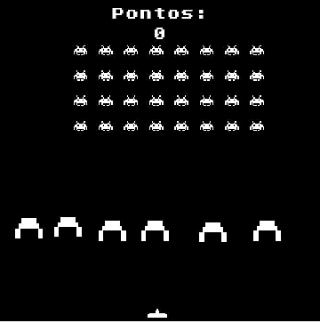
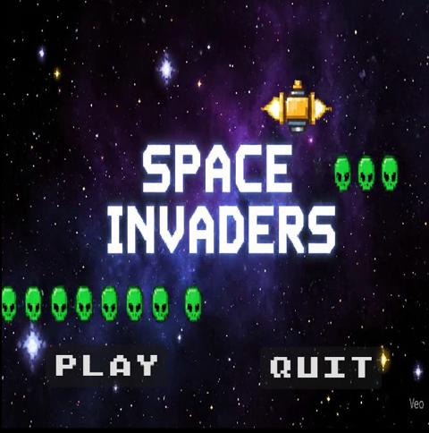
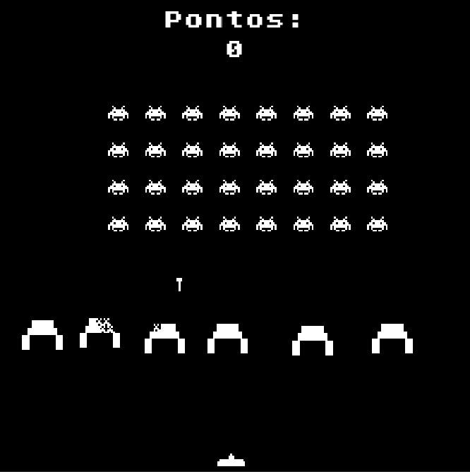

# 👾 Space Invaders — Godot 4

Releitura do clássico **Space Invaders** feita em **Godot 4.2 (GDScript)**, com menu animado, nave bônus e **chefão**.

🎮 **[Jogar no navegador](https://dimitri7.github.io/space-invaders-godot/)** *(teclado; no primeiro acesso, se aparecer um aviso de "SharedArrayBuffer", recarregue a página com F5)*



---

## 🕹️ Como jogar

| Tecla | Ação |
|---|---|
| ← → | Mover a nave |
| Espaço | Atirar |

## ✨ Funcionalidades

- **Menu** com fundo animado em vídeo e botões *Play* / *Quit*
- **Grade de 32 aliens** que marcha em bloco e atira de volta
- **Barreiras destrutíveis**, que vão sendo corroídas pelos tiros
- **Nave bônus** que aparece de tempos em tempos (+500 pontos)
- **Placar**: +100 pontos por alien
- **Chefão**: ao chegar a **3000 pontos**, entra uma fase de chefe com vida própria e padrão de tiro
- **Game over** e retorno ao menu

| Menu | Partida |
|---|---|
|  |  |

## 🛠️ Tecnologias

**Godot 4.2** · **GDScript** · exportação **Web (HTML5/WebAssembly)** publicada no GitHub Pages

## 🧠 O que pratiquei

- **Cenas e instâncias** (`PackedScene`): aliens, tiros, barreiras e bônus criados em tempo de execução
- **Sinais** para comunicar eventos entre cenas (ex.: `bonus_eliminado` → soma de pontos)
- **Grupos e colisões** (`Area2D`, `is_in_group`) para separar alien, chefão e barreira
- **Timers** para o ritmo dos aliens e o surgimento da nave bônus
- **Troca de cenas** (menu → partida → chefão → game over)

## 📁 Estrutura

```
cenas/      cenas (.tscn) e scripts (.gd) do jogo
Sprites/    imagens
sfx/        efeitos sonoros
fonts/      fontes
media/      GIF e prints deste README
docs/       versão Web exportada (publicada no GitHub Pages)
```

## ▶️ Como abrir o projeto

1. Instale o [Godot 4.2](https://godotengine.org/download/archive/4.2-stable/).
2. Abra o Godot → **Import** → selecione o arquivo `project.godot` desta pasta.
3. Aperte **F5** para jogar.

## 🙏 Créditos

- Vídeo de fundo do menu gerado com **Veo** (Google).

---

👤 **Dimitri Gomes de Albuquerque** · [GitHub](https://github.com/Dimitri7) · [LinkedIn](https://www.linkedin.com/in/dimitri-albuquerque-66b32b278/)
